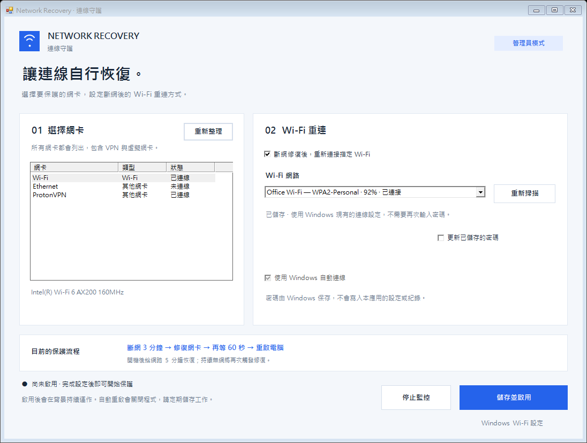

# Network Recovery · 連線守護

Windows 自動斷網修復工具。第一次執行時選擇網卡與 Wi-Fi，之後在背景偵測實際上網狀態，必要時修復網卡或重新啟動電腦。

**下載：[v0.1.1 預發行版本](https://github.com/kay786-003/network-recovery/releases/tag/v0.1.1)**。可直接下載 EXE，或下載 Windows 壓縮包。支援 Windows 10/11；需要 .NET Framework 4.8 Runtime 及管理員權限。尚未安裝時，請先從 [Microsoft 官方頁面下載 .NET Framework 4.8 Runtime](https://dotnet.microsoft.com/en-us/download/dotnet-framework/net48)。



## 第一階段功能

- 列出本機網卡，包括停用、隱藏、VPN 和虛擬網卡，讓使用者選擇一張。
- Wi-Fi 網卡可選擇一個可用或已儲存的 Wi-Fi，並啟用 Windows 自動連線。
- 已儲存的 Wi-Fi 重用 Windows 設定；新 Wi-Fi 會要求密碼。
- 密碼輸入錯誤時，可重新掃描並勾選「更新已儲存的密碼」後再試；啟用前會確認所選 Wi-Fi 已連線。
- 密碼只透過 Windows WLAN API 傳給 Windows，不寫入應用設定、紀錄、命令列或專案。
- 單一 EXE，開啟時要求管理員權限。啟用後，即使關閉視窗、登出或重新開機，也由 Windows 排程在背景執行。
- 可在應用內停止監控；系統匣圖示的右鍵選單可勾選暫停 1／2／4／24 小時，再點已勾選的同一項即可取消暫停。
- 目標 Wi-Fi 不在範圍但看得到其他網路時，持續掃描並重試 Windows 已儲存、可連線的 Wi-Fi；沒有任何可見 SSID 時才繼續網卡修復流程。
- 「監控工具」只有「備份」、「還原備份」、「一鍵修復並重設」、「移除備份」四個按鈕。修復需明確確認，先驗證或建立可還原的 Proxy、Winsock 與 IP 備份。

仍只設定一張網卡與一個主要 Wi-Fi；其他候選只來自 Windows 已儲存設定，主要 Wi-Fi 優先，其餘依設定名稱排序輪流重試。自訂多 Wi-Fi 優先順序與時間設定尚未實作。

## 使用

使用前必須關閉睡眠與休眠：在「電源與睡眠」把螢幕與睡眠都設為「永不」，並以 `powercfg /hibernate off` 關閉休眠。監控在睡眠或休眠期間不會執行，本工具也不處理跨睡眠／休眠的計時。

1. 建置完成後執行 `dist/NetworkRecovery-v<產品版本>-dev-<建置時間>.exe`，或解壓縮 Windows 應用套件後執行其中的 EXE，核准 Windows 管理員權限提示。首次設定（尚無應用設定及監控工作）會先測試外網；Microsoft、Cloudflare、Google 三個檢查服務都沒有回應時，程式會提示並結束，請確認網路、Proxy 或防火牆後再執行。
2. 選擇實際用來上網的網卡。只開啟視窗不會啟用監控。
3. 若選 Wi-Fi，勾選重新連線並選擇 Wi-Fi。尚未儲存的網路會出現密碼欄位。
4. 按「儲存並啟用」。Wi-Fi 設定會交給 Windows，監控會安裝為本機的背景排程。
5. 關閉視窗即可。系統匣右鍵選單提供狀態、四個暫停時長、監控工具及停止。暫停中只有目前時長打勾；再點同一項取消，點另一時長則重新起算，到期自動取消勾選。系統匣在安裝者登入時啟動；登出後 SYSTEM 監控仍繼續，暫停也仍有效。
6. 「監控工具」可先按「備份」保存目前網路設定，不會覆寫既有備份。「一鍵修復並重設」會驗證既有備份，若尚無備份則先建立，再清 DNS、修復所選網卡並重設 Proxy／Winsock／TCP/IP。使用目前登入帳戶的管理員權限；以其他管理員帳戶提升權限時會拒絕改 Proxy。
7. 修復或還原成功後只顯示「需要重新啟動才能生效」的提醒，按「確定」關閉提醒，由使用者自行重新啟動電腦。工具視窗沒有重啟或暫停按鈕。既有自動監控策略仍由系統匣控制；「還原備份」可復原設定，「移除備份」需確認後才刪除本機備份。

高 DPI 顯示會依 Windows 縮放比例調整；若視窗小於完整設定畫面，請使用水平／垂直捲軸存取下方按鈕。首次使用顯示「尚未安裝」是正常狀態，按「儲存並啟用」後才建立監控排程。

啟用時會依所選 Wi-Fi 送出連線要求；若切換網路，遠端連線可能短暫中斷。自動重新啟動會強制關閉程式，未儲存的工作可能遺失。

## 第一階段的固定流程

| 情況 | 動作 |
| --- | --- |
| 平常持續無法上網 3 分鐘 | 重啟選定網卡，並依選擇重新連線 Wi-Fi |
| 修復完成後再等 60 秒仍無法上網 | 重新啟動電腦 |
| 開機後持續無法上網 | 前 5 分鐘觀察連線；等待結束後觸發修復，再等 60 秒決定是否重新啟動 |

檢查的是多個外部服務的實際回應，因此 Wi-Fi 顯示已連線卻無法上網，也會觸發流程。間隔有數秒的檢測及 Windows 操作延遲。本次未發行建置已實作 D0007：任意連續 4 小時最多重啟 5 次；外網檢查成功即歸零。達到上限後仍持續修復網卡與重新連線，額度隨各筆重啟紀錄到期恢復。計數只保存在目前這台電腦，重開機後繼續沿用，不同步到其他電腦。GitHub v0.1.1 附件仍是舊行為。

本次未發行建置另已實作下列決策（GitHub v0.1.1 附件尚不包含）：

| 已決定的行為 | 決策 |
| --- | --- |
| 目標 Wi-Fi 不在範圍時不消耗重啟次數，改為持續掃描等待它回來 | D0008 |
| 自動重試其他在 Windows 已儲存密碼的 Wi-Fi | D0008 |
| 重新啟動前先保存含 UTC 時間與原因的簡易紀錄；寫入失敗不重啟 | D0011 |
| 系統匣、暫停 1／2／4／24 小時，到期或取消後重新起算修復時間及重啟窗 | D0012 |
| 手動分階段修復、進階重設前備份、失敗嘗試還原 | D0013 |
| 本機保存重啟額度，開機間用 UTC 銜接、同次開機用單調時間 | D0014 |

外網判定維持單一標準：任一個檢查服務有回應就視為可以上網，不做 DNS／TCP／HTTP 分層探測（D0009）。這是刻意的取捨——以遠端存取公司電腦為主要用途時，寧可偶爾多重新啟動一次，也不要因判定過於保守而長時間連不上。

## Wi-Fi 與系統支援

- 支援 Windows 10/11，需安裝 .NET Framework 4.8 Runtime。Windows 11 已包含相容的 .NET Framework 4.x；Windows 10 請先確認已安裝 4.8 或更新的 4.x Runtime。尚未安裝時，請使用 [Microsoft 官方 .NET Framework 4.8 Runtime 下載頁](https://dotnet.microsoft.com/en-us/download/dotnet-framework/net48)，不需要安裝 Developer Pack。
- 網卡列舉及修復使用 Windows PowerShell 5.1 的 NetAdapter 模組。Wi-Fi 掃描需要 WLAN AutoConfig；位置權限可能受 Windows 設定或公司原則限制。
- `build.ps1` 使用 Windows 隨附的 Framework C# 編譯器，不需要安裝 .NET SDK 或 NuGet 套件。
- 新連線支援開放網路、WPA2-Personal AES，以及系統與網卡支援的 WPA3-Personal SAE。
- 企業／802.1X、WEP、特殊驗證或公司原則管理的連線，請先在 Windows 完成設定，再選擇已儲存的連線。本工具不建立企業憑證或登入設定。
- 背景監控以 SYSTEM 執行，需要所有使用者可用的 Wi-Fi 設定。僅限單一使用者的連線會顯示處理說明，不會直接覆寫。
- Windows 若限制 Wi-Fi 掃描的位置權限，請在「隱私權與安全性 → 位置」允許桌面應用存取；公司政策可能需要由管理員處理。
- 路由器、電信線路、登入網頁或 VPN 服務本身故障，未必能透過重啟網卡或電腦排除。
- 電腦必須保持開機：請關閉睡眠與休眠（見「使用」），睡眠期間監控不會執行，本工具也不處理跨睡眠／休眠的計時。

## 安裝位置

| 用途 | 位置 |
| --- | --- |
| 已安裝程式 | `%ProgramFiles%\NetworkRecovery\NetworkRecovery.exe` |
| 設定 | `%ProgramData%\NetworkRecovery\config.xml` |
| 重啟額度（跨重啟保留） | `%ProgramData%\NetworkRecovery\restart-history.xml` |
| 紀錄（UTC 時間） | `%ProgramData%\NetworkRecovery\events.log` |
| 暫停／狀態 | `%ProgramData%\NetworkRecovery\control.xml`、`status.xml` |
| 手動修復備份（僅管理員／SYSTEM 可讀寫） | `%ProgramData%\NetworkRecovery\repair-backup` |
| Windows 工作排程名稱 | `NetworkRecovery Monitor`、`NetworkRecovery Tray` |

應用檔案與設定僅供管理員及 SYSTEM 修改。設定檔只有網卡識別碼、Wi-Fi 設定名稱及時間，沒有 Wi-Fi 密碼。

升級時先關閉舊設定視窗，再執行這次下載／建置的 EXE，按「儲存並啟用」。只開啟視窗不切換監控。程式先備份檔案與排程，停止舊的 `NetworkRecovery Monitor` 及 `NetworkRecovery Tray`，替換安裝檔與設定，確認新排程持續執行。早期 `Codex Network Recovery` 會停止並停用，保留排程定義供失敗時還原，不刪除舊腳本或私人資料。

切換失敗會嘗試還原舊 EXE、設定與監控／系統匣排程狀態；若還原不完整會報錯並保留備份。已知排程之外，自訂名稱的排程、啟動資料夾或手動執行的舊 PowerShell 不會自動辨識或刪除，須自行停止，以免雙重監控。舊版沒有記錄的重啟次數無法補算；現有新版額度與暫停狀態在升級時保留。實際升級及失敗還原仍待實機驗收。

## 建置

在專案資料夾執行：

```powershell
powershell -NoProfile -ExecutionPolicy Bypass -File .\build.ps1
```

輸出為 `dist/NetworkRecovery-v<產品版本>-dev-<建置時間>.exe` 及 SHA-256 摘要；`dist/current-build.txt` 記錄這次產物檔名。正式發行由 `release.ps1` 產生不含 dev 後綴的版本化 EXE，Windows ZIP 內檔名亦一致。也可透過 Visual Studio 開啟 `NetworkRecovery.csproj`。目前的 EXE 尚未做發行者數位簽章。

維護者使用 `powershell -NoProfile -ExecutionPolicy Bypass -File .\release.ps1 -Version 0.1.1` 準備版本化附件；此指令只做本地驗證與封裝，不會發布。附件固定放在 `dist/releases/v<版本>/`。推送對應的 `v<版本>` 標籤後，`.github/workflows/release.yml` 會重新驗證並發布預發行 Release。

執行 `powershell -NoProfile -ExecutionPolicy Bypass -File .\tests\run.ps1` 可檢查 Wi-Fi XML、密碼與啟動策略，唯讀查詢工作排程器，並短暫開啟示範視窗檢查按鈕遮擋與縮放（請先執行 build.ps1），不會儲存 Wi-Fi、操作網卡、安裝排程或重新啟動。

## 專案目錄與 GitHub

```text
src/                     應用程式原始碼與管理員權限 manifest
docs/                    操作與驗證資料
docs/reference/          原始參考腳本（不直接執行；D0013 由 EXE 分階段實作）
.github/workflows/       GitHub Actions 建置工作
AGENTS.md                Agent 的固定工作規範與閱讀順序
CHANGELOG.md             依版本記錄變更
CONTRIBUTING.md          開發、檢查與提交方式
SECURITY.md              密碼、權限與安全回報
build.ps1                本機建置指令
release.ps1              驗證版本及準備發行附件
NetworkRecovery.csproj   Visual Studio 專案
legacy/                  早期腳本與本機診斷紀錄，僅留在本機
dist/                    建置產物
```

`legacy/` 含這台電腦的舊設定與紀錄，已加入 `.gitignore`。**不要使用網頁上傳整個資料夾來繞過忽略規則。** 可改用提供的 `dist/NetworkRecovery-source.zip`，該壓縮檔只包含可分享的原始碼與說明，不含舊設定或紀錄。

公開儲存庫：[kay786-003/network-recovery](https://github.com/kay786-003/network-recovery)。EXE 與壓縮包放在 [Releases](https://github.com/kay786-003/network-recovery/releases)，不放進 Git 原始碼歷史；也可自行建置。尚未選定開源授權，沒有 LICENSE 不代表可任意再授權或散布。

本機驗證範圍與後續驗收項目見 [docs/VERIFICATION.md](docs/VERIFICATION.md)。

## 文件索引與開發規範

| 固定路徑 | 用途 |
| --- | --- |
| [AGENTS.md](AGENTS.md) | 每個新 Agent session 必讀的範圍、契約及驗證規則 |
| [CHANGELOG.md](CHANGELOG.md) | 開發與發行變更，未發行內容放 `[Unreleased]` |
| [CONTRIBUTING.md](CONTRIBUTING.md) | 環境、修改、測試與提交流程 |
| [SECURITY.md](SECURITY.md) | 密碼、權限與安全回報方式 |
| [docs/ARCHITECTURE.md](docs/ARCHITECTURE.md) | 原始碼職責、背景監控及 Windows 整合 |
| [docs/VERIFICATION.md](docs/VERIFICATION.md) | 已完成的驗證及仍待實機驗收的項目 |
| [docs/ROADMAP.md](docs/ROADMAP.md) | 第一階段狀態與第二階段範圍 |
| [docs/DECISIONS.md](docs/DECISIONS.md) | 只追加、不覆寫歷史的架構決策 |
| [docs/ISSUES.md](docs/ISSUES.md) | 尚待修復或完成驗收的問題清單 |
| [docs/documentation-schema.json](docs/documentation-schema.json) | 正式文件的檔名、大小寫及章節順序 |

文件不可任意改名或建立重複副本。執行 `powershell -NoProfile -ExecutionPolicy Bypass -File .\tests\documentation.ps1` 檢查格式；GitHub Actions 也會執行相同檢查。

## 版本與後續工作

目前 GitHub 預發行版本為 `v0.1.1`，EXE 產品版本為 `0.1.1`、檔案版本為 `0.1.1.0`，仍屬第一階段。程式碼、文件和測試的通過狀態不等於已完成所有實機驗收。D0007～D0014 已在本次未發行建置整合；D0009、D0010 維持既有單一外網判定及關閉睡眠前提。自訂多 Wi-Fi 優先順序與可調時間仍未實作。隔離測試不等於已完成掃描／重連、暫停、升級或進階修復還原的實機驗收。
